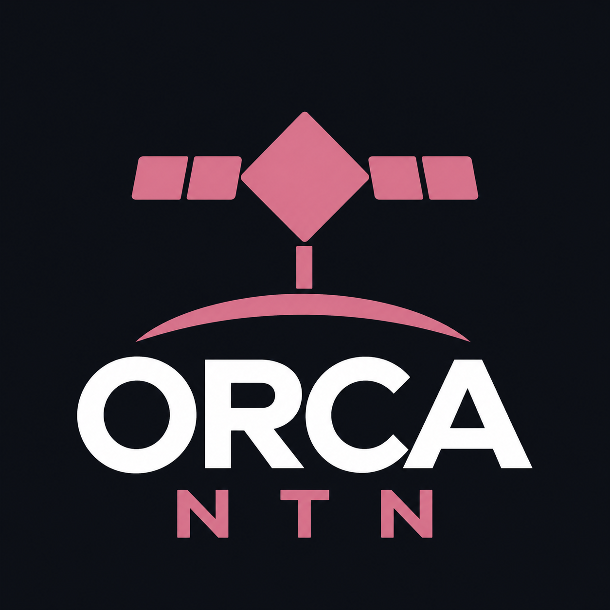
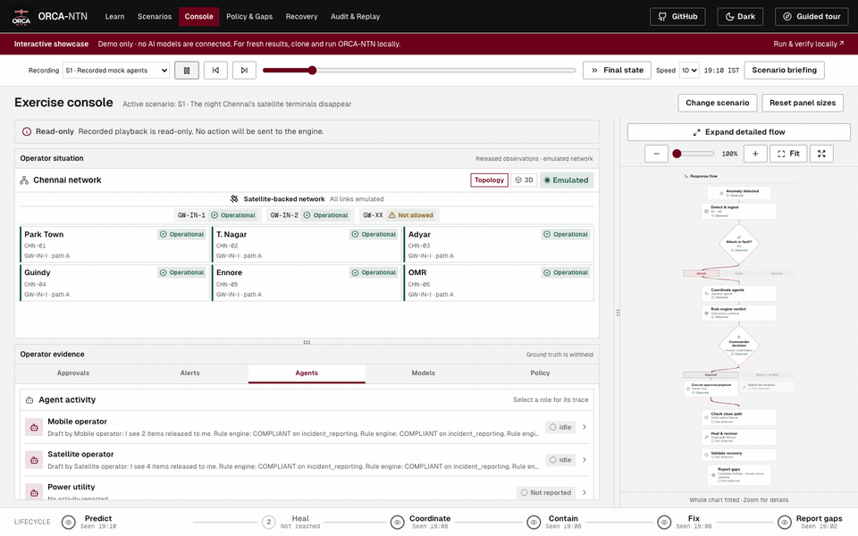
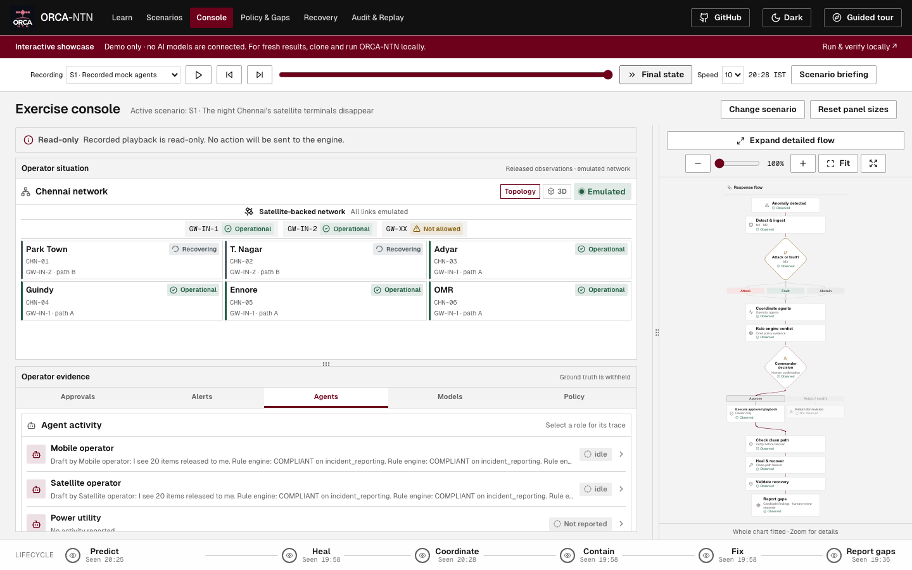
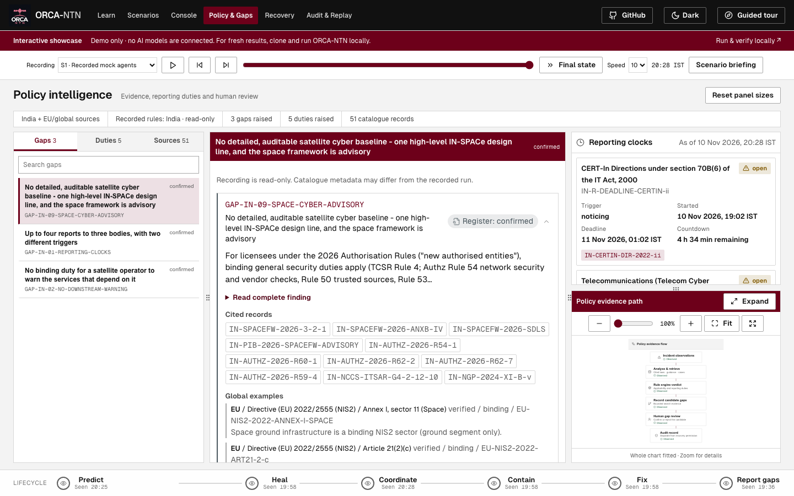
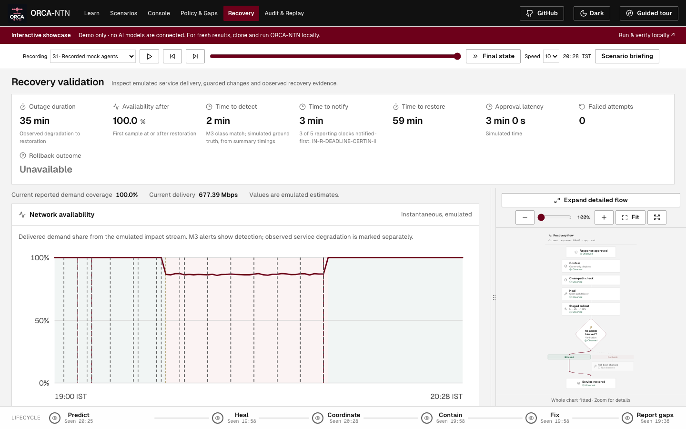
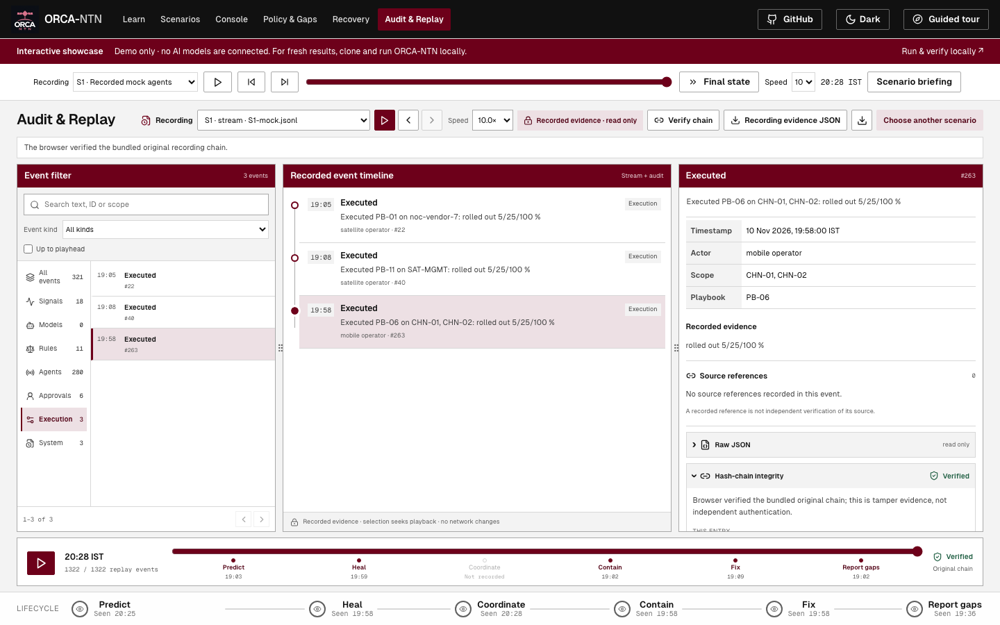
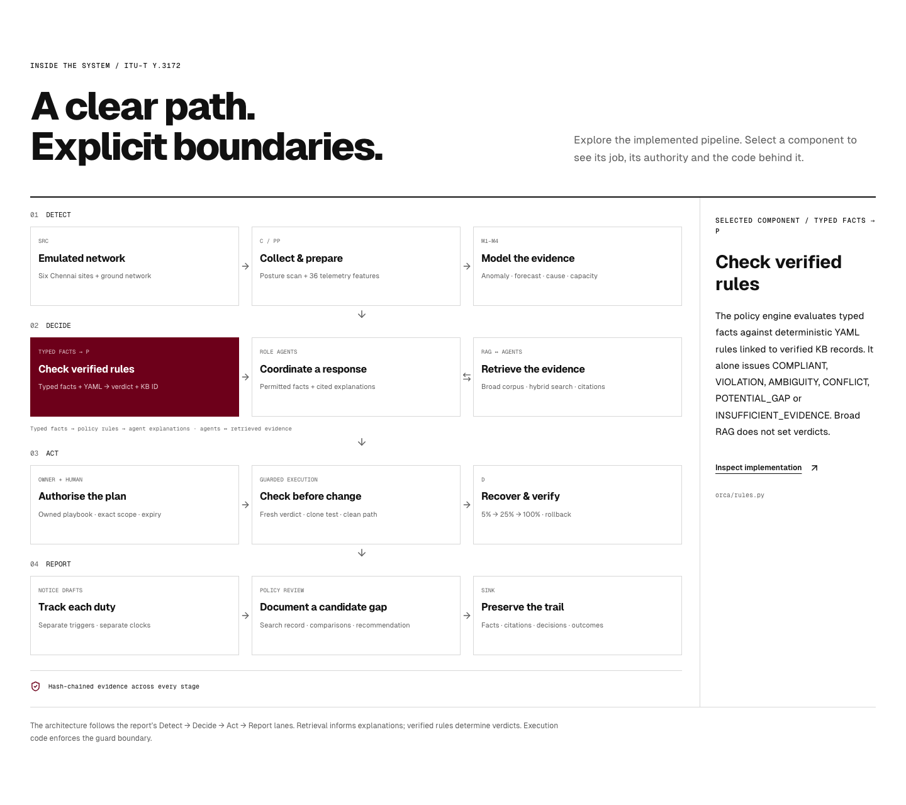

<p align="center">
  
</p>

<h1 align="center">ORCA-NTN</h1>
<p align="center"><strong>Cyber-aware coordination for NTN.</strong><br/>Team <strong>SolarSailor</strong> · SSN, Chennai · ITU AI for Good Sandbox Hackathon UAE</p>

<p align="center">
  <a href="https://orca-ntn.vercel.app"><strong>Explore the demo ↗</strong></a> &nbsp;·&nbsp;
  <a href="https://github.com/CharanVelavan/ORCA#quick-start">Run locally</a> &nbsp;·&nbsp;
  <a href="https://github.com/CharanVelavan/ORCA/blob/main/docs/JUDGE_REPRODUCIBILITY.md">Reproduce results</a> &nbsp;·&nbsp;
  <a href="https://huggingface.co/CharanVelavan/orca-ntn-qwen3.6-35b-a3b-ft-gguf">Fine-tuned Qwen</a>
</p>

<p align="center">
  
  
  
</p>

> **Hosted demo only:** no AI models are connected to the website. It plays recorded emulated
> scenarios. For fresh inference and reproducible results, clone and run the
> [full ORCA-NTN implementation](https://github.com/CharanVelavan/ORCA).

## This repository is the showcase

The complete implementation is maintained at **[CharanVelavan/ORCA](https://github.com/CharanVelavan/ORCA)**.
This separate repository hosts the learning experience and read-only dashboard playback on Vercel.



*Real browser-playback frames, accelerated for this GIF. Recorded emulated evidence; no live inference.*

## What you can explore

| Screen | What to inspect |
|---|---|
| **Learn** | NTN security, methodology, architecture, 3D topology, KB relationships and the narrated 4K film. |
| **Scenarios** | Ten detailed briefings, planned dimension coverage and capture source. |
| **Console** | Recorded telemetry, alerts, models, agents, approvals and a fitted, zoomable flowchart. |
| **Policy & Gaps** | Recorded cited verdicts, independent reporting clocks and candidate findings. |
| **Recovery** | Recorded approvals, stages, clean-path checks and re-attack outcomes. |
| **Audit & Replay** | Event inspection, browser verification of original bundled chains and public evidence export. |

| Recorded Console | Policy evidence |
|---|---|
|  |  |

| Recovery validation | Audit & Replay |
|---|---|
|  |  |



## Playback is not inference

- **Ten mock-agent captures** were generated with the actual emulated simulator, ML models and rules.
- **One separate S1 Qwen capture** was recorded using the project's fine-tuned model. There is no
  Qwen connection on this website, including when that recording is selected.
- Approvals and notifications during capture used a **scripted headless commander**. They are not
  independent human trials. All attacks, links and remediation actions are emulated.
- The browser verifies bundle SHA-256 values and each original JSONL hash-chain entry. Original
  files include synthetic exercise-control events for verification; operator views withhold them.
  A hash chain detects changes relative to its bundled anchor; it is not external authentication.
- Playback contains no fresh simulator, model, embedding, RAG-query or attack-launch service.
  Mutation calls are rejected before making any network request.

Use **Play**, **Pause**, event steps, the slider or **Final state**. The selected recording and
position remain shared as you navigate between evidence screens.

## Run this showcase locally

Use Node.js 24 or later and npm:

```bash
git clone https://github.com/CharanVelavan/ORCA_DEMO.git
cd ORCA_DEMO
npm ci
npm test
npm run dev
```

For a production build: `npm run build`, then `npm run preview`. No Python server, model weights,
API key or cloud VM is needed. `vercel.json` configures the Vite build and direct SPA route access.

## Run fresh experiments

```bash
git clone https://github.com/CharanVelavan/ORCA.git
cd ORCA
./quickstart.sh
```

On Windows use `.\quickstart.bat`. Read the main project's
[prerequisites and reproducibility guide](https://github.com/CharanVelavan/ORCA/blob/main/docs/JUDGE_REPRODUCIBILITY.md)
for Python 3.12, native libraries, optional verified HF downloads, local model serving, endpoint
connection and performance evaluation. Historical benchmark numbers cannot be re-measured by watching
a recording.

## Provenance and verification

Capture IDs, modes, checksums, source commits and limits are in
[`public/data/provenance.json`](public/data/provenance.json). The ten mock captures use implementation
commit `70aa88d`; the S1 Qwen recording was captured against baseline `d73ace6`.
See [the showcase verification record](docs/VERIFICATION.md), [the guide](guide.md) and
[the main project's measured results](https://github.com/CharanVelavan/ORCA/blob/main/docs/JUDGE_VERIFICATION.md).

The source preserves the project's burgundy/black/white design and the approved horizon logo.
Code is MIT licensed; cited source documents retain their original terms. Team **SolarSailor**, SSN, Chennai.
